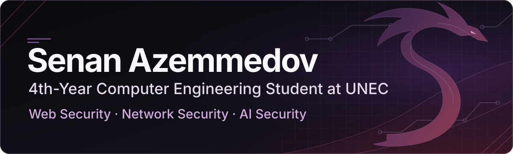
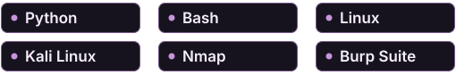

## About me

I’m Senan Azemmedov, a fourth-year Computer Engineering student at the Azerbaijan State University of Economics (UNEC). I’m interested in cybersecurity, especially web application security and penetration testing.

## Background

I previously trained in cybersecurity at MilliSec and practiced across 35+ CTF-style rooms on TryHackMe.

## Current focus

I’m refreshing my technical foundations through practical security projects, with an emphasis on testing, reproducibility, and clear reporting. My first planned project is a Python CLI that compares saved network inventory snapshots from an authorized lab or synthetic fixtures.

## Technical interests

- Web application security, penetration testing, and vulnerability assessment
- Network security and Python security automation
- AI security, AI-assisted cybersecurity, and security reporting

## Technical foundations

I’ve previously studied or practiced Python, Bash, Linux (including Kali Linux), Nmap, Burp Suite, and networking fundamentals such as HTTP.

## Professional links

[LinkedIn](https://www.linkedin.com/in/senan-azemmedov-71b20b351/)
